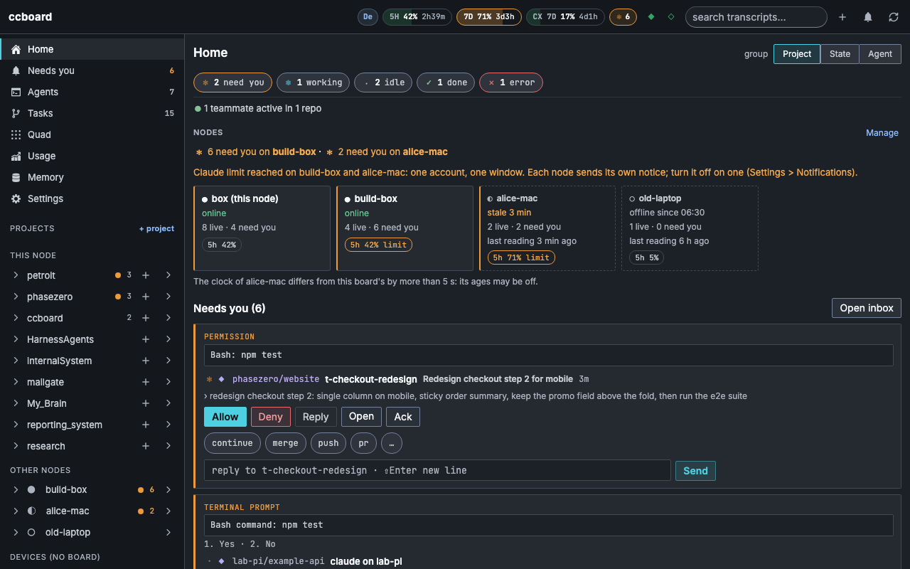
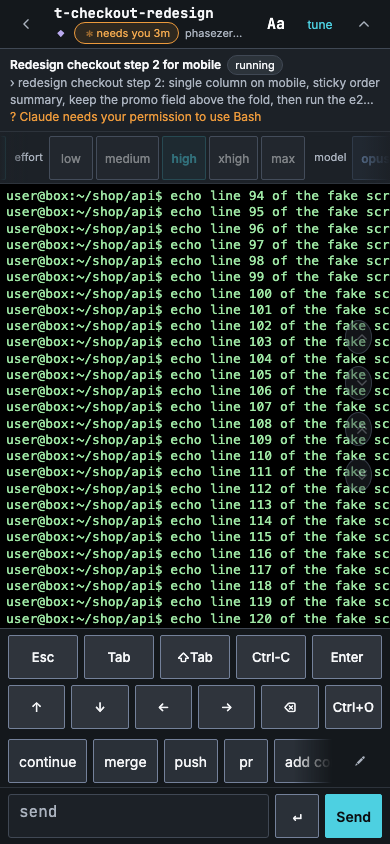

# ccboard

A self-hosted dashboard for Claude Code and Codex sessions that run in tmux on your own machine, reachable only over your Tailscale network.





ccboard is a status-and-attention layer. It starts the real `claude` or `codex` terminal program inside tmux, shows what is running where, lets you attach from any device (including your phone), and tells you when a session needs you. It never reimplements the agents or their chat, so every feature of Claude Code and Codex keeps working: slash commands, MCP, hooks, plan mode, resume, skills and worktrees.

**You open the board from another device on your tailnet, not from `localhost` on the machine that runs it.** The installer prints an address like `https://<name>.<tailnet>.ts.net`. Open it from your phone or laptop. A request to plain `http://localhost` carries no Tailscale identity, so the board answers 403. If you do want to use it on that one machine, there is an optional local sign-in, off by default: set `CCBOARD_LOCAL_SIGNIN=1`, restart the board and run `bin/ccboard-open` (see [Security](docs/security.md#security-model)). The systems it runs on, and what has been tested, are in [Supported systems](#supported-systems).

```
 browser (any device on your tailnet)
   │ https://<name>.<tailnet>.ts.net/        https://<name>.<tailnet>.ts.net:8443/
   ▼                                          ▼
 tailscale serve ──── /    ──► ccboard board (127.0.0.1:8000)
                 └─── /tty ──► terminal (127.0.0.1:7681) ──► tmux ──► your claude / codex sessions
                                          code-server (127.0.0.1:8080) ──► the same repositories
```

## What it does

- **Projects and sessions.** Start, resume and watch Claude and Codex sessions per project from one sheet. See [Home and projects](docs/guide/home-and-projects.md) and [The launcher](docs/guide/launcher.md).
- **An attention inbox and push.** Sessions that wait for you, hit a limit or finish rise to the top, and your phone is told. See [Notifications](docs/guide/notifications.md).
- **Tasks in worktrees, with pull requests and CI.** One task, one branch, one worktree, with the diff, the PR and the CI result on the board. See [Tasks, diffs and pull requests](docs/guide/tasks-and-prs.md).
- **Schedules.** Run a prompt on a timer, in a batch, or continue a session when its limit resets. See [Schedules, batches and auto-continue](docs/guide/automation.md).
- **Codex next to Claude.** The same launcher, state and usage for both agents. See [Using Codex with the board](docs/guide/codex.md).
- **Usage and accounts.** What each subscription has used, and several saved logins. See [Usage and cost](docs/guide/usage-and-cost.md) and [Accounts and login](docs/guide/accounts.md).

## What it is not

- Not a chat UI. The agent's own terminal is the interface; the board is around it.
- Not multi-user. One board per person, one Unix user, one list of allowed Tailscale logins. Teammates appear only as presence read from GitHub ([Team](docs/team.md)).
- Never public. No Funnel; everything binds to loopback and `tailscale serve` is the only way in.
- Not a transcript parser. State comes from tmux and the agents' hooks.

## Supported systems

"To verify" means the claim has not been run on a real machine of that kind yet. The device checks are tracked in issue #130. The first column is the list of systems in the table of [Nodes on each platform](docs/nodes/platforms.md), and a test keeps the two equal.

| System | Support | Tested on | Install page |
|---|---|---|---|
| Linux box | Supported, the reference platform: Ubuntu 22.04 or 24.04 with systemd, amd64 or arm64, installed by `./install.sh`. | Run on the maintainer's own Ubuntu machine; the test suite runs on Ubuntu 24.04 in CI. A fresh-machine walkthrough by someone else is still to do. | [Linux](docs/install/linux.md) |
| Linux container | Supported on a Linux host with Docker Engine (`CCBOARD_RUNTIME=docker`); the container is only the board's process, the tmux server and Tailscale stay on the host. An arm64 image is not Docker Desktop support. | Run on the maintainer's own Ubuntu machine; the arm64 image has not been started on a real ARM machine. | [Docker](docs/install/docker.md) |
| Mac | Supported for a Mac that stays logged in: macOS 13 or newer, Homebrew, its own installer (`./install.sh` hands over), per-user launchd jobs. Use the board from another device; saved Claude logins are not available. What it survives (sleep, lid closed, logout, reboot) and a Background job reaching the Keychain secret are to verify. On Intel, ttyd is a long source build. | One Intel Mac running macOS 14 (2026-10-10). Not run on Apple silicon. | [macOS](docs/install/macos.md) |
| WSL2 | Supported on Windows 11 22H2 or newer: the Linux install inside an Ubuntu distro with systemd, plus the Windows keep-alive (mandatory). Windows 10 is best effort. Not yet run on a real Windows machine (issue #130, W1 to W9): to verify. | Not run on a real Windows machine. | [Windows (WSL2)](docs/install/windows-wsl2.md) |
| Native Windows | Not supported (issue #124). Use WSL2. | Not applicable. | [Windows (WSL2)](docs/install/windows-wsl2.md) |

## What you need

- [ ] A machine of a supported kind (table above) that stays on while you want the board.
- [ ] Tailscale, signed in on that machine, with **MagicDNS** and **HTTPS certificates** turned on for your tailnet (Tailscale admin console, DNS page). See [Tailscale](docs/install/tailscale.md).
- [ ] A second device on the same tailnet to open the board from (a phone or laptop), because plain localhost is rejected.
- [ ] `sudo` on Linux, or Homebrew on a Mac. On a Mac, also install Claude Code (and Codex, if you use it) yourself before you run `./install.sh`: the Mac installer only prints how when one is missing, and it then skips the MCP registration (and, for Codex, its hooks) and the claude-mem plugin step, so you would have to rerun it.
- [ ] A Claude Code or Codex login. You do it from the board after the install (the *Log in* button).
- [ ] `gh` logged in on the machine, for the GitHub features (pull requests, CI, issues).

## Quick start

Install from `git clone`. Each system has one page with every step, what the installer changes and how to check it.

### Ubuntu 22.04 or 24.04

```sh
git clone https://github.com/rpandox/ccboard && cd ccboard
./install.sh          # from a terminal; on a remote machine use: ssh -t <host>
```

It installs the services, maps the HTTPS ports with `tailscale serve` and ends with `ccboard is installed.` and a Dashboard address. Open that address from another tailnet device and click *Log in*. Details: [Install on Linux](docs/install/linux.md).

### macOS 13 or newer

```sh
git clone https://github.com/rpandox/ccboard && cd ccboard
./install.sh          # as yourself, from a terminal; it never uses sudo
```

Install Claude Code first (and Codex if you use it): without `claude` the installer prints how, skips the MCP registration and the claude-mem plugin step, and leaves you to rerun it. It checks Homebrew and Tailscale, asks once before it installs missing tools (on an Intel Mac ttyd builds from source, and that took more than ten minutes on one Intel Mac), loads per-user launchd jobs and prints the Dashboard address. Open it from another device and click *Log in*. Details: [Install on a Mac](docs/install/macos.md).

### Windows 11 with WSL2

Not yet run on a real Windows machine (issue #130): to verify. It is the longest path.

1. In PowerShell: `wsl --install -d Ubuntu`, then `wsl --update`.
2. In the distro, put these lines in `/etc/wsl.conf` (`appendWindowsPath=false` keeps a Windows `claude` or `codex` from shadowing the Linux ones), then run `wsl --shutdown` in PowerShell and open the distro again:

   ```ini
   [boot]
   systemd=true

   [interop]
   appendWindowsPath=false
   ```

3. In the distro, on its own disk: `git clone https://github.com/rpandox/ccboard ~/ccboard && cd ~/ccboard && ./install.sh`. This needs a `tailscale` command inside the distro and stops with an error without one. If Tailscale runs only on Windows, put `CCBOARD_TAILSCALE_PLACEMENT=host CCBOARD_ALLOWED_USERS=you@provider CCBOARD_PUBLIC_URL=https://<this PC>.<your tailnet>.ts.net` in front of `./install.sh`, or the install stops; the install page says what `host` changes and why it is only for a PC you use alone.
4. Copy `scripts/windows/ccboard-wsl-keepalive.ps1` out of the distro to Windows and run it there, in PowerShell (mandatory: without it WSL stops and takes every session with it): `powershell -NoProfile -ExecutionPolicy Bypass -File .\ccboard-wsl-keepalive.ps1 -Distro <name>`, with the distro's name as `wsl -l -q` lists it (part 5 of the install page).
5. Open the printed address from another tailnet device and click *Log in*.

Details, networking and where Tailscale runs: [Install on Windows with WSL2](docs/install/windows-wsl2.md).

### Docker on a Linux host

Needs Docker Engine with the compose plugin and your user in the `docker` group. The container is only the board's process; tmux and Tailscale stay on the host.

```sh
git clone https://github.com/rpandox/ccboard && cd ccboard
CCBOARD_RUNTIME=docker ./install.sh
```

The installer pulls `ghcr.io/rpandox/ccboard`, switches the board over and prints the rollback. Open the address from another device. Details, a no-risk shadow run and the limits: [Run the board as a container](docs/install/docker.md).

To look around without installing, the sandboxed dev board and its `?demo=1` mode are described in [Developing ccboard](docs/development.md#demo-mode).

## Your first ten minutes

1. Open the printed Dashboard address on your phone (any device on the tailnet, not `localhost`).
2. Click *Log in* and sign in to Claude Code. The board's own login flow gives you a link to open in a browser and a code to paste back.
3. Create a project and clone a repository into it: the **+** menu, then the project wizard ([New project and clone](docs/guide/new-project-and-clone.md)).
4. Start a session in that repository from the launcher and open its terminal ([The launcher](docs/guide/launcher.md), [The terminal](docs/guide/terminal.md)).
5. Install the board as an app on your phone and turn on push, so a session that needs you can reach you ([Installing the board as an app](docs/guide/install-as-app.md), [Notifications](docs/guide/notifications.md)).

## Documentation

Every page is listed in [docs/README.md](docs/README.md). The old README headings and where each went are in [docs/moved.md](docs/moved.md).

| Page | What it covers |
|---|---|
| [Install on Linux](docs/install/linux.md), [a Mac](docs/install/macos.md), [Windows with WSL2](docs/install/windows-wsl2.md), [Docker](docs/install/docker.md) | One procedure per system. |
| [Tailscale](docs/install/tailscale.md) | Why the board needs it, the two admin-console switches and the command per system. |
| [Configuration](docs/configuration.md) | Every setting, grouped, starting with the few most people set. |
| [Upgrade](docs/upgrade.md), [Uninstall](docs/uninstall.md), [Backup and restore](docs/backup-and-restore.md) | Keeping an install current, removing it, and getting it back. |
| [Security](docs/security.md) | What the board trusts and exposes, and the node scopes. |
| [Troubleshooting and FAQ](docs/troubleshooting.md) | Known problems and what to do. |
| [Getting started](docs/guide/getting-started.md) | The tour of the board, with a page per feature under `docs/guide/`. |
| [Several devices](docs/nodes/overview.md) | Nodes, pairing, the hub, epics and the device check. |
| [Doctor](docs/reference/doctor.md) and [Hooks](docs/reference/hooks.md) | The self-check and the hook scripts. |
| [Team](docs/team.md) | Who is working on what, from GitHub. |
| [Developing ccboard](docs/development.md) and [Deploying](docs/maintainers/deploying.md) | Run it locally, the tests, demo mode, and how the container image is shipped. |

## Security in four lines

- The board is reachable only over your tailnet: it binds to loopback and `tailscale serve` is the only way in. It never uses Funnel.
- It lets in only the Tailscale logins in `CCBOARD_ALLOWED_USERS` (by default your own).
- The terminal (`/tty`) and code-server do not check that list: any device your tailnet rules let reach those ports gets a shell as your user, so keep your tailnet access rules tight.
- Everything runs as your own Unix user, with that user's files.

More in [Security](docs/security.md).

## Contributing, support and licence

Contributions are welcome: see [CONTRIBUTING.md](CONTRIBUTING.md). For help or a bug report, open an issue at <https://github.com/rpandox/ccboard/issues>. ccboard is released under the MIT licence ([LICENSE](LICENSE)).
